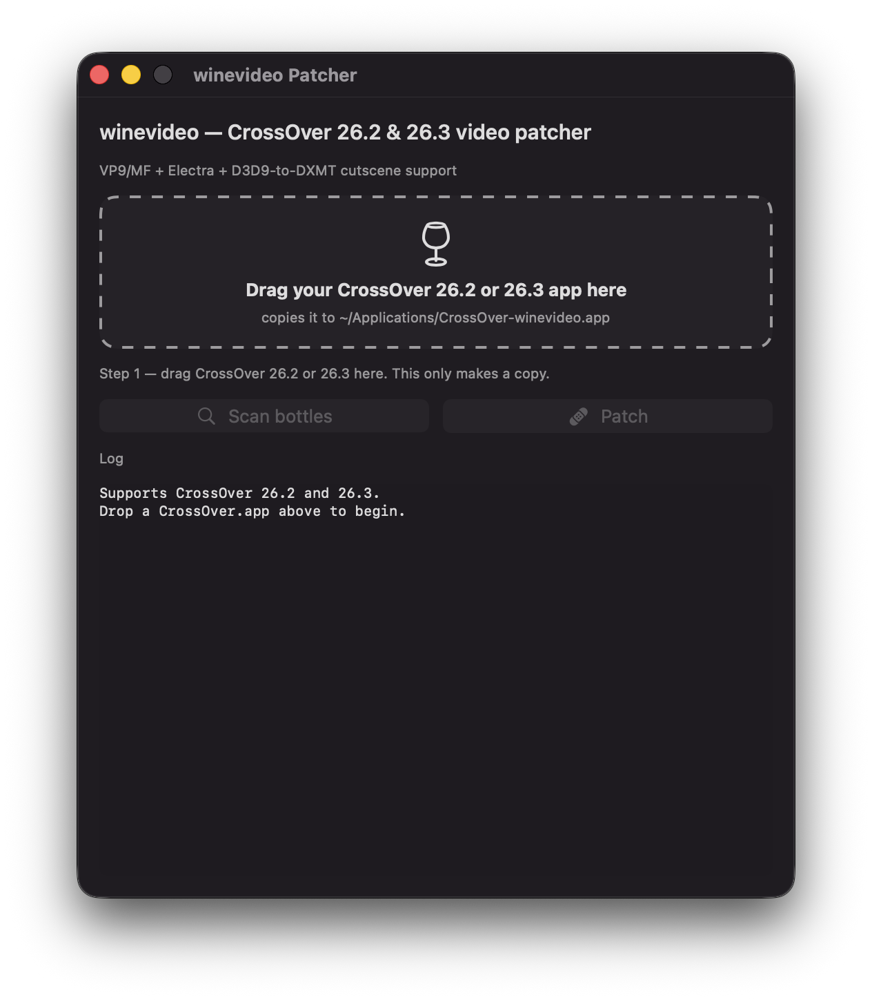

# winevideo

Cutscene compatibility patches for CrossOver 26.2 and 26.3 on Apple Silicon.

winevideo patches a duplicate CrossOver application and one selected bottle. It
adds missing Windows video support without modifying the original CrossOver app
or redistributing proprietary game files.

  

## What it does

- Adds VP9/WebM decoding and Media Foundation registration for games such as
  **Ninja Gaiden 4**.
- Adds Media Foundation software-output fixes used by supported Unreal Engine
  ElectraPlayer titles.
- Optionally imports WMV/VC-1 codecs from the user's official GStreamer install
  for **Nioh**, **Nioh 2**, **Persona 5 Strikers**, and other Windows-media
  titles.
- Adds an opt-in D3D9-to-DXMT video bridge for the shared-texture cutscene path
  used by **Nioh**, **Nioh 2**, and **Persona 5 Strikers**.

## Requirements

- Apple Silicon Mac.
- Stable CrossOver **26.2 or 26.3**. CrossOver Preview is not supported.
- Official GStreamer **1.24.13** is required for Nioh, Nioh 2, Persona 5 Strikers,
  Returnal, Ghostwire Tokyo, and WMV/VC-1 titles such as RE Engine games. It is
  optional for supported UE5 ElectraPlayer titles and is not required for
  Ninja Gaiden 4's bundled VP9 path.

## Install

1. Download `winevideo-Patcher-macOS.zip` from
   [Releases](https://github.com/Jfishin/winevideo/releases).
2. Open **winevideo Patcher** and drag your CrossOver 26.2 or 26.3 app into the
   window. The patcher creates and patches a duplicate; the CrossOver app you
   dropped in stays pristine.
3. Select the bottle containing the game and click **Patch**.
4. Launch `CrossOver-winevideo.app` from the user Applications folder.

Only the selected bottle receives the game-specific setup. Other bottles are
left untouched.

## Tested video paths

| Game or engine | Video path | Additional setup |
|---|---|---|
| Ninja Gaiden 4 | VP9/WebM through Media Foundation | Select its bottle in the patcher. |
| Nioh | WMV3 through DirectShow/VMR9 and the D3D9-to-DXMT bridge | GStreamer 1.24.13 codec source; select its bottle. |
| Nioh 2 | Windows Media through the D3D9-to-DXMT bridge | GStreamer 1.24.13 codec source; select its bottle. |
| Persona 5 Strikers | ASF/VC-1 through the Koei Tecmo shared-texture path | GStreamer 1.24.13 codec source; select its bottle. |
| Supported UE5 ElectraPlayer titles | H.264/AAC through Media Foundation | Per-game `Engine.ini`; GStreamer is optional. |

See the [compatibility guide](https://github.com/Jfishin/winevideo/wiki/Game-Compatibility)
for tested games, exact requirements, and known blockers.

## Documentation

- [Installation guide](https://github.com/Jfishin/winevideo/wiki/Installation)
- [Codecs and GStreamer](https://github.com/Jfishin/winevideo/wiki/Codecs-and-GStreamer)
- [Nioh series and Persona 5 Strikers bridge](https://github.com/Jfishin/winevideo/wiki/Nioh-and-Persona-5-Strikers)
- [UE5 ElectraPlayer setup](https://github.com/Jfishin/winevideo/wiki/UE5-ElectraPlayer)
- [Architecture](https://github.com/Jfishin/winevideo/wiki/How-It-Works)
- [Troubleshooting](https://github.com/Jfishin/winevideo/wiki/Troubleshooting)
- [Building and patch provenance](https://github.com/Jfishin/winevideo/wiki/Building-and-Patch-Provenance)

## Licensing

The prebuilt payload contains modified Wine components and open-source
GStreamer/libvpx components. Corresponding Wine patches and provenance are
provided in this repository. winevideo does not ship FFmpeg/libgstlibav; the
patcher can copy those libraries from the user's own GStreamer installation.

## Disclaimer

This is an unofficial community modification supplied as-is, without warranty.
Always patch a duplicate CrossOver application. Do not ask CodeWeavers to
support a modified CrossOver copy.

winevideo is not affiliated with or endorsed by CodeWeavers, Apple, or any game
publisher. CrossOver and all game names remain trademarks of their respective
owners.

## AI disclosure

The project is AI-generated, human-directed, and tested on real games and
reproducible harnesses. Review the source and patches before use.

## Credits

- **[CrossOver](https://www.codeweavers.com/crossover) by CodeWeavers** provides
  the Wine distribution and macOS integration that winevideo patches. Users
  supply their own CrossOver app; winevideo only modifies a duplicate.
- **[Wine](https://www.winehq.org/)** supplies the Windows compatibility and
  media implementations modified by the included source patches.
- **[Valve's Proton](https://github.com/ValveSoftware/Proton)** is the upstream
  source of the Wine VP9 work ported into the project.
- **[GE-Proton](https://github.com/GloriousEggroll/proton-ge-custom)** provided
  additional Wine media integration patterns and references used during the
  broader codec investigation.
- **[GStreamer](https://gstreamer.freedesktop.org/)** and
  **[libvpx](https://github.com/webmproject/libvpx)** provide the open-source
  demuxing and VP9 components used by the redistributable payload. Optional
  FFmpeg-backed codecs come from the user's own GStreamer installation.
- **[CXPatcher](https://github.com/italomandara/CXPatcher)** informed the
  drag-and-drop duplication, quarantine, and macOS application-patching model.

Detailed patch provenance and licensing are maintained in the wiki and source
manifest.
